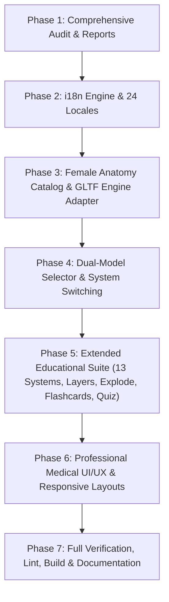

# IMPLEMENTATION PLAN: COMPLETE MULTILINGUAL HUMAN ANATOMY ATLAS
**Repository:** `ajaynxt/body`  
**Working Branch:** `feature/multilingual-human-atlas`  
**Execution Standard:** Evidence-Backed, Incremental, Non-Destructive  
**Date:** 2026-10-16  

---

## 1. Architectural Strategy & Non-Destructive Principles

1. **Isolation First:** All modifications occur on `feature/multilingual-human-atlas`. Original `main` branch remains untouched and deployable.
2. **Unified Dual-Model Architecture:**
   - Both models live in the same application, toggleable by a top-level **Model Switcher** (`Male` / `Female`).
   - The Male model continues to stream from `public/models/atlas.json` + `public/models/body-*.bin.gz` via our GPU DataTexture engine.
   - The Female model is loaded via GLTF/GLB loader (`female-atlas.glb`) using `zer01dollars/female-body-atlas` mesh catalog (888 meshes, CC BY 4.0).
   - Data structures are completely isolated so meshes, concept IDs, and system hierarchies are never cross-pollinated or mixed between sexes.
3. **No Heavy Downloads at Initial Load:**
   - Default initial load fetches the user's selected model (Male by default).
   - Female model (`female-atlas.glb`) is loaded on-demand via dynamic `import()` and streaming fetch when the user switches to Female.
4. **Zero Paid APIs / Zero Hallucinated Anatomy:**
   - Pure client-side WebGL, Three.js, React, and local storage.
   - Transparent coverage metrics: unsupported structures in either model are clearly flagged.

---

## 2. Step-by-Step Implementation Roadmap

### Phase 1: Audit & Documentation (Completed)
- Created `docs/audit/AUDIT_REPORT.md`
- Created `docs/audit/ANATOMY_DATA_COVERAGE.md`
- Created `docs/audit/LICENSES_AND_ATTRIBUTION.md`
- Created `docs/audit/LANGUAGE_COVERAGE.md`
- Created `docs/audit/IMPLEMENTATION_PLAN.md`

### Phase 2: Complete Internationalization (i18n) Engine
- Implement `src/i18n/index.ts` with locale registry for 24 languages.
- Create modular locale dictionary `src/i18n/translations.ts` containing interface strings, system names, controls, study modes, and quiz phrases.
- Add RTL layout switcher that applies `dir="rtl"` to `<html>` and dynamically mirrors flex/grid styles for Arabic (`ar`) and Urdu (`ur`).
- Implement multilingual anatomical synonym mapper for search in `src/data/multilingualSynonyms.ts`.

### Phase 3: Female Anatomy Catalog & Dual-Engine Adapter
- Create `src/data/femaleMeshCatalog.ts` containing the verified 888 meshes, FMA IDs, names, and 10 system classifications derived from HuBMAP VHF 1.5.
- Update `src/engine/ThreeViewer.ts` or add `FemaleSceneManager.ts` to render GLB geometry with standard Three.js materials, raycasting, selection, hover, and explode kinematics.
- Store `female-atlas.glb` or configure on-demand streaming from verified public CDN/local asset with loading bar and offline caching.

### Phase 4: Model Selector & State Orchestration
- Update application state in `src/App.tsx` with `gender: 'male' | 'female'`.
- Add highly visible model selector toggle in `Header.tsx` with clean badge indicators.
- Preserve camera orbit controls, zoom, and lighting when switching models.
- Gracefully reset selection and camera framing when switching between male and female figures.

### Phase 5: Educational Suite Expansion (13 Systems & Study Modes)
- **13 Anatomical Systems:** Skeletal, Muscular, Nervous, Circulatory, Respiratory, Digestive, Urinary, Male/Female Reproductive, Endocrine, Lymphatic, Integumentary, Sensory, Connective.
- **Study Modes:**
  1. *Explore 3D:* Free orbit, click selection, isolate, auto-rotation.
  2. *Study by System:* System selector with organ list and verified coverage badge.
  3. *Layer Mode:* Sliders for Skin Opacity (0–100%) and Deep Muscle transparency to reveal internal viscera.
  4. *Continuous Explode View:* 0–100% smooth separation slider.
  5. *Flashcards:* Active recall review cards with pronunciation and high-yield facts.
  6. *Quiz Mode:* Multiple choice and 3D organ identification questions.
  7. *Compare Mode:* Side-by-side or quick toggle between male and female organ anatomy with coverage differences highlighted.
  8. *Glossary:* Multilingual anatomical terminology search.

### Phase 6: Professional Medical UI/UX Overhaul
- Top header with brand identity, model selector, language dropdown (native scripts), theme toggle (dark/light), and global search.
- Collapsible left dock for anatomical systems and study modes.
- Spacious central 3D viewport.
- Resizable / collapsible right detail panel displaying preferred name, Latin terminology, system, basic function, clinical correlation, exam pearls, citations, and source identifiers.
- Mobile bottom sheet with touch gestures.

### Phase 7: Verification, Testing & Delivery
- Run `tsc -b` and `vite build`.
- Run `oxlint` on all changed files.
- Verify RTL rendering in Arabic and Urdu.
- Verify model switching without memory leaks.
- Create `docs/audit/TEST_REPORT.md` and user guide.
